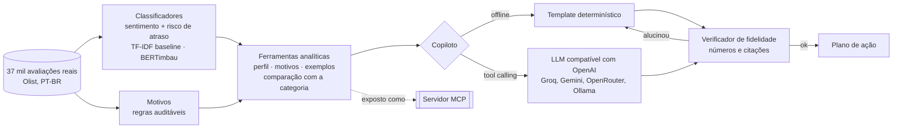

# Copiloto do Parceiro 🛍️🤖

[](https://github.com/anapbatista/copiloto-parceiro/actions/workflows/ci.yml)


> Um lojista de marketplace recebe centenas de avaliações por mês. Ele não tem tempo de ler
> todas — mas cada uma diz exatamente o que está fazendo ele perder venda.

O **Copiloto do Parceiro** lê as avaliações **reais** de clientes (37 mil, em português, do
marketplace Olist), classifica sentimento e risco de atraso com modelos treinados e avaliados
com rigor, descobre **por que** os clientes reclamam e entrega ao parceiro um **plano de ação**
— com cada número e cada citação **verificados automaticamente** contra os dados.

Feito para o problema que todo marketplace (de produtos ou de comida) tem do lado do parceiro:
transformar feedback bruto em ação, sem que a IA invente nada.

## Exemplo de saída

```text
# Copiloto do Parceiro · `4a3ca931`
Categoria: cama_mesa_banho · Período: 2017-01-08 a 2018-08-21 · Avaliações com texto: 820

## Como você está
- Nota média 3,56; 26,8% das avaliações são negativas (mediana da categoria: 23,1%).
- 14,4% dos pedidos chegaram depois do prazo prometido (mediana da categoria: 8,6%).
- Nos últimos 3 meses a taxa de negativas melhorou: 18,2% (antes: 27,9%).
- O modelo achou 15 avaliações com nota alta mas texto negativo: reclamações que a nota esconde.

## O que mais gera reclamação (nota até 3)
1. Pedido não recebido: 24,5% das reclamações (81 ocorrências).
   > “Foi cobrado frete e a mercadoria não chegou até minha casa. Tive que retirar nos correios.”
   - Ação: Acompanhar rastreio dos pedidos em aberto e acionar a transportadora antes do cliente reclamar.
...
modo: deterministico · fidelidade: OK (27 números, 3 citações verificados)
```

## Arquitetura



**Princípio: a IA interpreta, o código calcula.** Todas as métricas saem de funções testadas
(`analytics.py`). O LLM só escolhe ferramentas e redige. Antes de entregar, o
`faithfulness.py` confere cada número e cada trecho citado contra as saídas das ferramentas;
se o LLM inventar algo, o copiloto devolve o relatório determinístico.

| Módulo | Responsabilidade |
|---|---|
| `data.py` | Baixa os dados públicos e cria os rótulos **reais**: sentimento (nota) e atraso (entrega real × prometida). |
| `model.py` | Classificadores com **divisão temporal** (treino até fev/2018, validação mar/2018, teste abr–ago/2018). |
| `reasons.py` | 8 motivos de reclamação com regras transparentes e ação recomendada para cada um. |
| `analytics.py` | Ferramentas: perfil, motivos, exemplos literais e comparação com parceiros da mesma categoria. |
| `agent.py` | Copiloto determinístico + agente com tool calling e *fallback* seguro. |
| `faithfulness.py` | Eval de fidelidade: números e citações precisam existir nas evidências. |
| `mcp_server.py` | As ferramentas como servidor MCP para Claude Desktop, Cursor ou outros agentes. |
| `train/finetune.py` | Fine-tuning do BERTimbau com perda ponderada e publicação no Hugging Face Hub. |

## Avaliação

`python evals/run_evals.py --markdown` (roda no CI a cada push):

| Métrica | Resultado |
|---|---|
| Sentimento: macro-F1 / acurácia (12.061 avaliações de teste) | 0,668 / 0,826 |
| Sentimento: F1 da classe negativa | 0,788 |
| Risco de atraso pelo texto: ROC-AUC / PR-AUC (taxa base 6,2%) | 0,851 / 0,491 |
| Regra "atraso/não recebido" vs. atraso real: precisão / recall | 0,408 / 0,542 |
| Relatórios 100% fiéis aos dados (50 maiores parceiros) | 50/50 (1.347 números, 149 citações) |
| Detecção de número inventado / citação inventada | 98% / 100% |
| Latência para gerar um relatório (p50) | 34 ms |

O que esses números contam:

- **Divisão temporal, não aleatória.** O modelo é treinado no passado e testado no futuro, como em produção.
- **Drift real.** A taxa de atraso foi de 27,8% em mar/2018 (validação) para 6,2% no teste. O PR-AUC cai de 0,83
  para 0,49 por isso — o ROC-AUC, que não depende da taxa base, fica estável. Em produção isso pede recalibrar o limiar.
- **"Neutro" é a classe difícil** (nota 3 = avaliações mistas), por isso o macro-F1 fica abaixo da acurácia.
- **A regra de atraso discorda do dado em parte por um motivo real:** muitos clientes avaliam *antes* de receber
  ("ainda não chegou") mesmo quando a entrega acaba saindo no prazo.
- **Detecção de 98%:** em 1 de 50 casos o número inventado coincidiu com um número verdadeiro do relatório.

### Fine-tuning (BERTimbau → Hugging Face)

O baseline TF-IDF roda em segundos e serve de piso. O `notebooks/finetune_colab.ipynb` ajusta o
[BERTimbau](https://huggingface.co/neuralmind/bert-base-portuguese-cased) com a **mesma divisão temporal**
(GPU T4 gratuita, ~15 min) e publica o modelo com *model card* e métricas no Hugging Face Hub.

## Como usar

```bash
git clone https://github.com/anapbatista/copiloto-parceiro && cd copiloto-parceiro
pip install -e ".[dev,mcp]"
python -m copiloto.data            # baixa ~50 MB de dados públicos e cria os rótulos
python -m copiloto.model           # treina o baseline (~15 s) e imprime as métricas
python -m copiloto parceiros       # lista parceiros
python -m copiloto relatorio 4a3ca9315b744ce9f8e9374361493884
pytest                             # 19 testes (usam uma amostra, sem rede)

# Com LLM (qualquer endpoint compatível com a API da OpenAI):
pip install -e ".[llm]"
export COPILOTO_LLM_MODEL=llama-3.3-70b-versatile COPILOTO_LLM_BASE_URL=https://api.groq.com/openai/v1 OPENAI_API_KEY=...
python -m copiloto relatorio <seller_id>

# Como servidor MCP (stdio):
python -m copiloto.mcp_server
```

## Limitações e próximos passos

- Dados de e-commerce de 2016–2018; o mesmo pipeline vale para avaliações de restaurantes quando houver dados rotulados.
- Motivos por regras são auditáveis, mas têm cobertura limitada (64% das avaliações negativas recebem ao menos um motivo).
  Próximo passo: anotar uma amostra e treinar um classificador multirrótulo de motivos.
- [ ] Publicar o BERTimbau ajustado no Hugging Face e comparar com o baseline nesta tabela.
- [ ] Avaliar o modo LLM em escala (taxa de *fallback* por modelo e custo por relatório).

## Dados e licença

Código sob MIT. Dados: [Brazilian E-Commerce Public Dataset by Olist](https://www.kaggle.com/datasets/olistbr/brazilian-ecommerce)
(CC BY-NC-SA 4.0, uso não comercial); a amostra em `tests/fixtures/` é derivada desse dataset.
Autoria: [Ana Paula de Abreu Batista](https://www.linkedin.com/in/anapbatista-).
