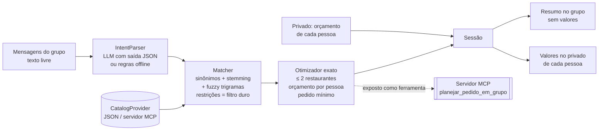

# PedeJunto 🍔🍕 — agente de IA para pedidos em grupo

[](https://github.com/anapbatista/pedejunto-agent/actions/workflows/ci.yml)


> Todo mundo já viveu isso: 8 pessoas num grupo de WhatsApp, cada uma quer uma coisa,
> ninguém quer falar quanto pode gastar, e o pedido sai 1h depois — ou não sai.

O **PedeJunto** é um agente que lê o que cada pessoa escreveu no grupo, recebe no
**privado** o orçamento de cada uma e devolve um pedido **otimizado em até 2 restaurantes**,
garantindo que ninguém paga mais do que o próprio limite (item + sua parte da taxa de entrega).

**Origem:** a ideia nasceu no **Hackathon iFood de Agentes de IA (SEMCOMP 2026, ICMC-USP)**, onde
nosso time ficou em **4º lugar** construindo um agente + bot de WhatsApp sobre o MCP oficial do
iFood. Este repositório é a minha reimplementação open source do núcleo do agente, reescrita do
zero com foco em corretude do otimizador, avaliação e arquitetura plugável (catálogo fictício).

---

## Demo

```text
=== GRUPO ===
Ana: gente, eu quero um hambúrguer vegano hoje
Bruno: to afim de um smash com bacon
Carol: pizza margherita pra mim
Davi: qualquer coisa de frango, pode ser lanche
Elis: quero algo vegetariano, pode ser pizza
Fábio: um x burguer sem cebola

=== PRIVADO (só o bot vê) ===  ana: 40 | bruno: 45 | carol: 38 | davi: 35 | elis: 50 | fabio: 32

=== BOT NO GRUPO ===
Pedido fechado em 2 restaurante(s):

*Burger Lab* (chega em ~35 min)
- Ana: Burger de Grão-de-Bico
- Bruno: Smash Duplo Bacon
- Davi: Chicken Crispy
- Fábio: X-Burguer Clássico

*Nonna Pizza* (chega em ~45 min)
- Carol: Pizza Margherita Individual
- Elis: Pizza Margherita Individual

Os valores de cada um foram enviados no privado.

=== BOT NO PRIVADO (Fábio) ===
Item: R$ 28,90 + sua parte da entrega: R$ 2,00 = R$ 30,90.
Dentro do seu limite de R$ 32,00 (sobram R$ 1,10).
```

Rode você mesma: `python -m pedejunto` (sem dependências externas).

## Arquitetura



| Módulo | Responsabilidade |
|---|---|
| `intent.py` | Extrai pratos, restrições (vegano, vegetariano, sem lactose, sem glúten) e exclusões ("sem cebola"). `LLMIntentParser` usa qualquer endpoint compatível com a API da OpenAI (OpenAI, Groq, Ollama, vLLM) com JSON validado e **fallback automático** para o parser de regras em caso de erro/timeout. |
| `matching.py` | Score de aderência desejo → item em [0, 1]. Entende gíria ("japa", "x", "pf") e erro de digitação ("piza calabreza"). |
| `optimizer.py` | Escolhe restaurantes e itens. Detalhes abaixo. |
| `session.py` | Estado da conversa: mensagens do grupo, orçamentos privados, pendências, fechamento. |
| `messages.py` | Mensagens de saída com **regra de privacidade**: o grupo nunca vê valores. |
| `mcp_server.py` | Expõe o planejador como ferramenta MCP para Claude Desktop, Cursor ou outros agentes. |

## O otimizador (a parte divertida)

**Problema.** Cada pessoa recebe no máximo 1 item; o grupo usa no máximo K = 2 restaurantes; a
taxa de entrega de cada restaurante é dividida igualmente entre quem pediu nele; o custo de cada
pessoa não pode passar do seu orçamento; cada restaurante precisa atingir o pedido mínimo.
Objetivo lexicográfico: **(1)** servir o máximo de pessoas, **(2)** maximizar
`aderência − λ · custo/orçamento`.

**O que torna difícil:** a parte da taxa de cada pessoa depende de *quantas* pessoas ficam no
mesmo restaurante, então a restrição de orçamento é não-linear.

**A sacada:** fixar os contadores. Para um par de restaurantes (A, B) e um número kA de pessoas
em A, a taxa por pessoa vira constante e o problema se decompõe:

1. **Caminho rápido (todos servidos):** escolher quais kA pessoas vão para A é exato ordenando
   `uA − uB` (argumento de troca). Se a escolha gulosa quebra um pedido mínimo, busca exata entre
   os C(n, kA) subconjuntos.
2. **Fallback (orçamento não fecha para todos):** programação dinâmica sobre as pessoas com estado
   `(a, b)`, permitindo deixar alguém sem pedido; a pessoa recebe no privado uma sugestão de ajuste.

A corretude é verificada contra **força bruta** em cenários aleatórios (abaixo).

## Avaliação

`python evals/run_evals.py --markdown` (roda no CI a cada push):

| Métrica | Resultado |
|---|---|
| Restrições alimentares (acurácia, 30 frases) | 100% |
| Item certo no top-1 (30 frases) | 100% |
| Planos ótimos vs. força bruta (300 cenários aleatórios) | 100% |
| Violações de orçamento | 0 |
| Violações do limite de 2 restaurantes | 0 |
| Latência, 6 pessoas × 8 restaurantes (p50 / p95) | 48 ms / 58 ms |
| Latência, 10 pessoas × 8 restaurantes (p50 / p95) | 95 ms / 127 ms |
| Latência, 15 pessoas × 8 restaurantes (p50 / p95) | 337 ms / 426 ms |

> Honestidade sobre os números: o conjunto de intenções é pequeno e foi escrito à mão sobre o
> catálogo de exemplo — serve como teste de regressão, não como benchmark. O resultado mais forte
> é o do otimizador, comparado com força bruta em cenários gerados aleatoriamente.

## Como usar

```bash
git clone https://github.com/anapbatista/pedejunto-agent && cd pedejunto-agent
python -m pedejunto                      # demo offline
pip install -e ".[dev,mcp]" && pytest    # 17 testes
python evals/run_evals.py --markdown     # avaliação

# Com LLM (qualquer endpoint compatível com a API da OpenAI):
pip install -e ".[llm]"
export PEDEJUNTO_LLM_MODEL=gpt-4o-mini   # ou llama3.1 com PEDEJUNTO_LLM_BASE_URL=http://localhost:11434/v1
python -m pedejunto

# Como servidor MCP (stdio):
python -m pedejunto.mcp_server
```

Uso como biblioteca:

```python
from pedejunto import GroupOrderSession

s = GroupOrderSession()
s.on_group_message("ana", "Ana", "quero um temaki")
s.on_private_message("ana", "meu limite é 40")
result = s.close()
print(result.group_text)
```

## Próximos passos

- [ ] Adaptador `CatalogProvider` para servidores MCP de catálogo reais.
- [ ] Webhook do WhatsApp Cloud API (o `GroupOrderSession` já é o cérebro do bot).
- [ ] Mais de um item por pessoa e itens compartilhados (ex.: pizza grande dividida).
- [ ] Avaliar o `LLMIntentParser` em um conjunto maior de mensagens reais anonimizadas.

## Créditos

Ideia original desenvolvida em time no Hackathon iFood de Agentes (SEMCOMP 2026). Esta
implementação é de autoria de [Ana Paula de Abreu Batista](https://www.linkedin.com/in/anapbatista-).
Restaurantes e cardápios são fictícios.
